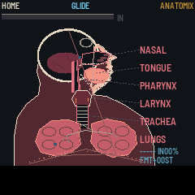
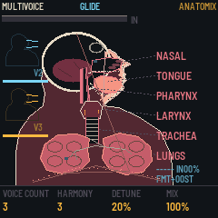
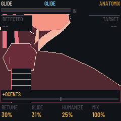
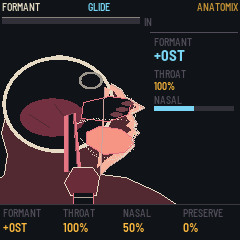
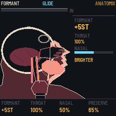
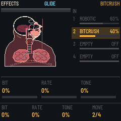
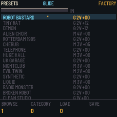
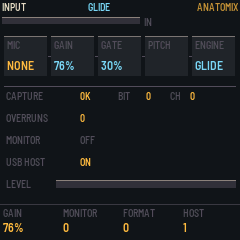
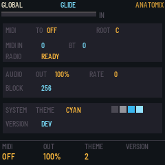

# ANATOMIX VOXINATOR

ANATOMIX VOXINATOR is firmware for the M-VAVE FM-1. A USB microphone goes in and a corrected, harmonised,
formant-shifted voice comes out, while the screen shows a cross-section of a head and throat that moves with
what you do. Two engines do the work. MULTIVOICE sings your voice with harmonies. GLIDE pulls the voice onto
the notes of a scale.



---

## Contents

1. Install
2. The screens
3. The microphone
4. MULTIVOICE
5. GLIDE
6. The vocal tract
7. The effects
8. The presets
9. INPUT
10. GLOBAL
11. Pages and knobs
12. The control map
13. Saving
14. Troubleshooting

---

## 1. Install

**Try it first.** The website's emulator runs the same code in the browser, with sound, played with the mouse.

**Install.** Open the install page in Chrome or Edge, connect the FM-1 by USB and press Install. While it
writes, the FM-1's screen shows UPDATING and a bar. Do not unplug the cable or switch the FM-1 off until the
page says it is done. If the FM-1 still runs M-VAVE's own FM1 Open firmware, put M-VAVE's original firmware
back first (M-VAVE's workbench, *Restore original*) and then install.

**From a terminal**, in the repository:

```sh
python3 base/tools/fm1_install.py app/build/anatomix.fwsc
```

The keyboard of the instrument is not needed for any of it.

**The microphone needs a powered hub.** The FM-1's USB port does not supply power to the device it is
connected to. A bus-powered microphone will not work, and no setting changes this: it is the hardware. Put a
powered hub between the microphone and the FM-1. This is the one thing to know before you buy a microphone.

## 2. The screens

The instrument has eight screens. They share a frame: a header, the picture in the middle, and the foot
with the four knobs' names and their values.

**HOME** is the whole anatomy: the head, the throat, the lungs, the airflow and the effects. HOME opens it.

**MULTIVOICE** shows the vocal paths and the voices. LFO and SEQ open it.

**GLIDE** shows the vocal folds, the detected pitch and the corrected pitch. ALGORITHM opens it; ARP
switches the engine and comes here.

**FORMANT** shows the enlarged head and the vocal tract. EDIT opens it.

**EFFECTS** shows the four slots. FX opens it.

**PRESETS** shows the factory and the user presets. SEL opens it.

**INPUT** shows the microphone and what the host has negotiated. ENV opens it.

**GLOBAL** shows MIDI, the output, the theme and the version. GLO opens it.

## 3. The microphone

The FM-1 is the USB host. The microphone is a USB Audio Class device, plugged into the FM-1.

**The FM-1's USB port does not supply power to the device.** A bus-powered microphone will not work. A powered
hub is required. This is a property of the hardware, not a setting.

44.1 kHz is preferred and 48 kHz works too. Mono and stereo both work. 16-bit and 24-bit both work. The
firmware converts whatever the microphone sends to the engine's 44.1 kHz.

With no microphone connected the instrument stays silent and the anatomy breathes on its own.

The INPUT screen has GAIN, MONITOR, FORMAT and HOST. Section 9 has them in full.

## 4. MULTIVOICE

MULTIVOICE is the original voice plus up to three processed ones: pitch-shifted harmonies, an octave
doubling, scale-aware harmony, detuned voices or formant-shifted voices. Each voice has its own place in
the stereo field, its own level and its own send into the effects chain.

The four voices start at 0, +3, +7 and −12 semitones from the lead: the voice itself, a minor third up, a
fifth up and an octave down.

K1 VOICE COUNT sets how many voices sing, one to four. K2 HARMONY picks the interval the harmonies are
built from, in the key and the scale. K3 DETUNE shakes the voices apart. K4 MIX sets the levels of the
processed voices.

On the screen the extra voices are smaller ghosted copies of the anatomy, each with its own colour and its
own moving folds.



## 5. GLIDE

GLIDE is monophonic pitch correction. The detected fundamental is moved to the nearest permitted note of the
chosen key and scale.

K1 RETUNE sets how fast the voice arrives at the target: 0 leaves the voice alone, 25 is subtle, 50
noticeable, 75 aggressive, 100 instant and robotic.

K2 GLIDE sets how the pitch travels between notes: 0 an instant change, 25 slightly softened, 50 a smooth
portamento, 75 an exaggerated slide, 100 an extreme glide that never quite settles.

K3 HUMANIZE adds a controlled variation to sustained notes, so a held note is not dead still.

K4 MIX sets the corrected voice against the dry one, 0 to 100.

The engine also has FORMANT, −12 to +12 semitones; OCTAVE, −2 to +2; the key, C to B; and the scale:
chromatic, major, minor, pentatonic or custom. FLEX sets how much of your own pitch variation survives the
correction; on the FORMANT page it is the PRESERVE knob.

The screen shows the folds, the detected pitch and the target apart from it: the original is one indicator,
the corrected one a second, dimmer. The folds glow brighter as the pitch rises.



## 6. The vocal tract

The FORMANT screen is the head and the vocal tract, enlarged. It is the shape of the mouth and the throat,
not the pitch: the same note can be spoken by a child or by a giant, and this is the knob that moves between
them.

K1 FORMANT shifts the tract, −12 to +12 semitones. Up is short and bright, down is long and dark.

K2 THROAT sets how much of the shift is applied, 0 to 100.

K3 NASAL sets the lead voice's own formant offset, −12 to +12 semitones: the colour of the nose in the voice.

K4 PRESERVE is FLEX: how much of your own pitch variation survives the correction.

On the screen a high formant shortens and brightens the tract and a low one lengthens and darkens it. The
tongue moves with it.



The same screen with the formant pushed up: the tract is shorter, the tongue sits higher, and the head reads
BRIGHTER.



## 7. The effects

Four slots, in series, in the order you put them. Each slot holds an effect with an on and off, three
parameters and a wet/dry mix, and has its own feedback on the anatomy.

| Family | The effects |
| --- | --- |
| Dynamics | noise gate, compressor, limiter, de-esser, input EQ |
| Character | saturation, overdrive, fuzz, bitcrusher, telephone, radio, vocal distortion |
| Modulation | chorus, flanger, phaser, tremolo, ring modulation, vocal doubler |
| Space | slapback delay, tape delay, ping-pong delay, stereo delay, reverb, shimmer |
| Experimental | formant filter, robotic modulation, pitch glitch, granular stutter, vocal freeze, spectral degradation, vocoder-style coloration |

The library holds about thirty effect types. Which effect each slot holds, and whether it is on, comes with
the preset. On the EFFECTS screen SELECT moves the focus from slot to slot, K1, K2 and K3 are the focused slot's
three parameters, and K4 MOVE moves the slot along the chain. The order is the sound: a distortion before a
filter is not a filter before a distortion. HOME's K4, FX MACRO, moves all four mixes at once, and the FX
screen shows each slot's mix as a bar.

Each effect shows itself on the anatomy: the delay leaves ghost outlines of the throat behind the original,
the reverb sends resonance rings out from the head, the distortion makes the airflow jagged. Over the top,
the meter turns red and the lungs inflate.



## 8. The presets

Sixteen factory presets and sixteen user presets. The factory ones are compiled into the firmware and cannot
be overwritten.

| # | Name | What it is |
| --- | --- | --- |
| 1 | ROBOT BASTARD | the extreme pitch correction |
| 2 | TINY RAT | a high formant and an octave up |
| 3 | DEMON | a deep formant shift |
| 4 | ALIEN CHOIR | several harmonies at once |
| 5 | ROTTERDAM 1995 | a distorted robotic vocal |
| 6 | CHERUB | bright harmonies |
| 7 | TELEPHONE | band-limited |
| 8 | HUGE HALL | a large reverb |
| 9 | UK GARAGE | subtle tuning and a delay |
| 10 | NIGHTCLUB | a doubler and some compression |
| 11 | EVIL TWIN | a detuned second voice |
| 12 | SYNTHETIC | hard digital tuning |
| 13 | LIQUID | a soft harmoniser |
| 14 | RADIO MONSTER | radio distortion |
| 15 | BROKEN ROBOT | pitch glitches |
| 16 | CLEAN STUDIO | the natural correction |

The browser lists sixteen names with a summary beside each: a letter for the engine, G or M, the number of
voices and the formant shift. The loaded one carries a star. K1 BROWSE moves through the slots, K2 CATEGORY
switches between the factory list and the user list, K3 LOAD loads the selected one and K4 SAVE writes the
current settings over the selected user slot.



## 9. INPUT

The INPUT screen is the microphone: at the top the device, the level, the gate, the pitch and the engine;
then the capture, its rate, its bit depth, its channels and its overruns; below that, the monitor and the
host.

K1 GAIN sets the input's level. K2 MONITOR switches the microphone's own signal into the speakers, before
any processing, so you can hear what the instrument hears. K3 FORMAT switches the rate between 44.1 and
48 kHz and the depth between 16 and 24 bits. K4 HOST switches the USB host on and off.



## 10. GLOBAL

The GLOBAL screen holds the settings that are not part of a preset.

K1 MIDI sets where the instrument's MIDI goes: OFF, USB, BT or ALL. K2 OUT sets the output level. K3 THEME
picks the palette of the screen, and K4 VERSION shows the version of the firmware. The screen also shows
the root of the scale, the MIDI in and the radio.



## 11. Pages and knobs

The instrument has fourteen buttons and seven encoders. The buttons open the screens; the encoders turn the
parameters.

| Button | Does |
| --- | --- |
| HOME | opens HOME |
| EDIT | opens FORMANT |
| FX | opens EFFECTS |
| GLO | opens GLOBAL |
| SEL | opens PRESETS |
| ENV | opens INPUT |
| LFO | opens MULTIVOICE |
| SEQ | opens MULTIVOICE |
| ARP | switches the engine and opens the matching screen |
| SAVE | stores the current settings in the selected user slot |
| OCT− / OCT+ | shifts the whole patch by an octave, −2 to +2 |

| Encoder | Does |
| --- | --- |
| K1–K4 | the four knobs of the screen on the display |
| ALGORITHM | switches between MULTIVOICE and GLIDE |
| PRESET | browses the presets |
| SELECT | the screen's own list: the focused slot on EFFECTS, the selected preset on PRESETS |

The sixteen white keys, the eleven black keys and incoming MIDI notes do nothing in this version. The
instrument is played with your voice.

## 12. The control map

Every screen, the button that opens it and the four knobs on it. On the website this section is
interactive: pick a screen and the knobs show what they do there.

| Screen | Opened by | K1 | K2 | K3 | K4 |
| --- | --- | --- | --- | --- | --- |
| HOME | HOME | VOICE COUNT | SPREAD | WET/DRY | FX MACRO |
| MULTIVOICE | LFO, SEQ | VOICE COUNT | HARMONY | DETUNE | MIX |
| GLIDE | ALGORITHM, ARP | RETUNE | GLIDE | HUMANIZE | MIX |
| FORMANT | EDIT | FORMANT | THROAT | NASAL | PRESERVE |
| EFFECTS | FX | the slot's parameter 1 | parameter 2 | parameter 3 | MOVE |
| PRESETS | SEL | BROWSE | CATEGORY | LOAD | SAVE |
| INPUT | ENV | GAIN | MONITOR | FORMAT | HOST |
| GLOBAL | GLO | MIDI | OUT | THEME | VERSION |

## 13. Saving

Sixteen factory presets, which cannot be overwritten, and sixteen user presets, which are yours.

SAVE stores the current settings into the user slot that is selected. The PRESETS screen does the same with
its knobs: K1 browses the slots, K2 switches between the factory list and the user list, K3 loads the
selected one and K4 saves over the selected user slot. A fresh user slot carries the factory preset's
name until you overwrite it.

The settings survive a power cycle: the instrument keeps the preset it was playing and the screen it was
left on.

The microphone's gain and the output level are global settings, separate from the presets. Loading a preset
never changes how the microphone is set up.

## 14. Troubleshooting

- **No sound from the microphone.** Start with the powered hub: the FM-1's USB port does not supply power,
  so a bus-powered microphone never starts at all. Then open INPUT and look at HOST: if the host is off, the
  instrument is not listening. Then turn MONITOR on: if the speakers carry the microphone's own signal, the
  instrument hears it too. If they carry nothing, the microphone is not reaching the FM-1.
- **The pitch will not lock.** The detector needs a level and a steady note. Turn INPUT's GAIN up until the
  meter sits in the amber. A breathy voice gives it noise instead of a note; the gate sits before the
  detector and closes on the breath, and the gate's setting comes with the preset.
- **Too much latency.** The engine works in blocks of 256 frames, 5.8 ms at 44.1 kHz, and the pitch shifter
  works from a ring of 46 ms of audio, so a shifted voice sits that far behind the dry one. The dry voice is
  a block away. HOME's K4, FX MACRO, fades the whole chain out: a delay and a reverb in it add their own
  time.
- **The screen does not react.** The encoders are read as detents and the counter is cleared on every read,
  so a movement that lands between two reads is lost. Turn the knob again, a little at a time. The anatomy
  is redrawn every frame at roughly 15 to 18 frames a second, so a fast turn can look like nothing happened.
- **Putting M-VAVE's own firmware back.** Use M-VAVE's workbench: *Restore original*.
- **The keys do nothing.** They do nothing in this version. The white keys, the black keys and incoming MIDI
  notes are not used yet.
